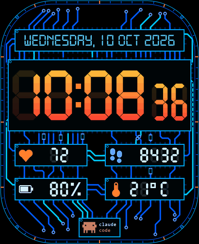
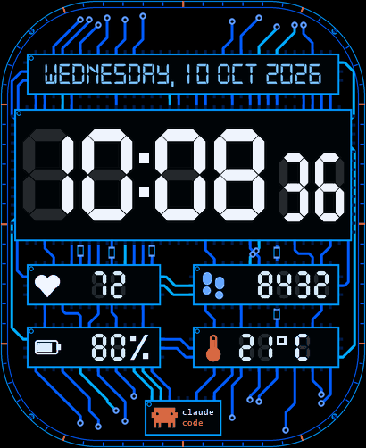
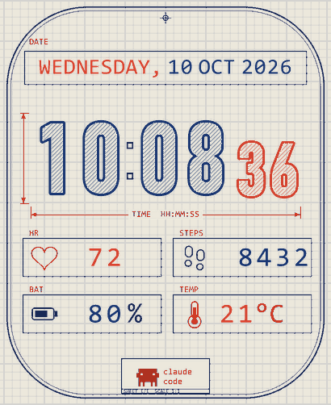
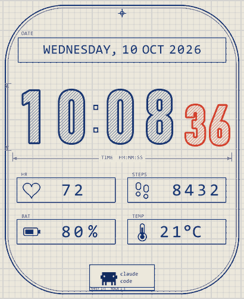
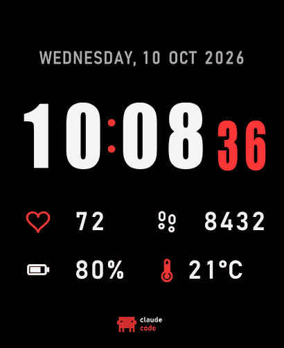
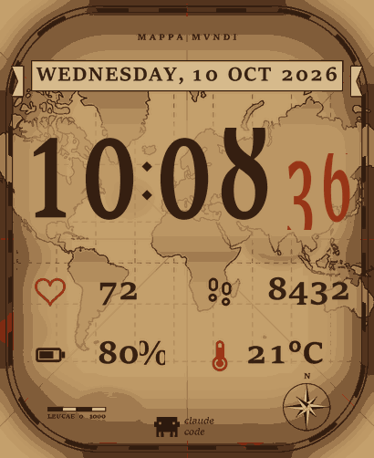
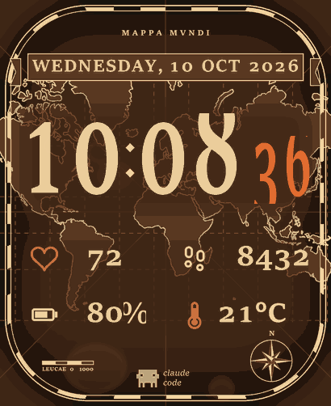
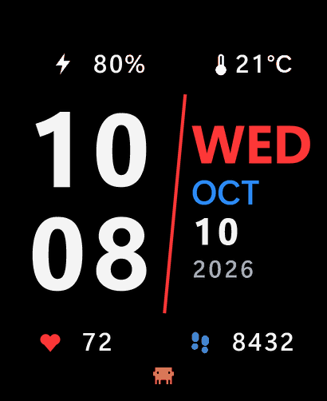
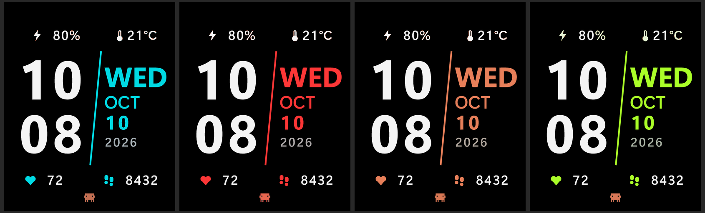

# Claude watch faces for the Redmi Watch 5 Lite

Custom watch faces for the **Xiaomi Redmi Watch 5 Lite** (410 × 502 AMOLED), generated with Python and compiled with [Mi Create](https://github.com/ooflet/Mi-Create)'s compiler. Ready-to-install `.face` files are in [`faces/`](faces/) and previews are in [`previews/`](previews/).

| | | |
|---|---|---|
|  **ClaudePCB Neon Sunset** |  **ClaudePCB Blue / White** |  **Blueprint, Vellum Red Pencil** |
|  **Blueprint, Vellum** |  **Minimal, Red** |  **Atlas, Parchment** |
|  **Atlas, Iron** |  **Stack, Red / Blue / White** |  **Stack: Cyan, Red, Orange, Lime** |

Colour-scheme sheets: [`palettes/`](palettes/) has 30 for PCB, 22 for Minimal and 22 for Blueprint.

## Styles
- **ClaudePCB:** each element sits in an IC-style frame with pins. The traces are routed octilinearly (45° bends only, minimum clearance) and the frames sit inside a bezel with tick marks. The clock is a 7-segment HH:MM with faint ghost segments and smaller seconds.
- **Blueprint:** a technical drawing. It has a grid sheet, hollow hatched digits, dimension lines, drafting labels and a title block. The *Red Pencil* variant marks the weekday, heart rate, temperature and logo in red.
- **Minimal:** pure black with an Impact clock and bold, readable stats.
- **Atlas:** an aged-parchment world map (Mercator, Natural Earth coastlines) with portolan rhumb lines, a compass rose, a scale bar and a ribbon banner.
- **Stack:** stacked bold hours and minutes, a slanted divider and a big weekday.

## Installing
On Android, install a `.face` with [Gadgetbridge](https://gadgetbridge.org/). This needs the watch's auth key: use the `encryptKey` from the Mi Fitness logs, or the BLE key from [Xiaomi Cloud Tokens Extractor](https://github.com/PiotrMachowski/Xiaomi-cloud-tokens-extractor). Leave the watch bound in Mi Fitness, and stop Mi Fitness while Gadgetbridge is connected.

## What the Redmi Watch 5 Lite needs (learned the hard way)
Faces that compiled without errors still rebooted the watch until they followed the structure of m0tral's working examples ([MiWatchLuaWatchfaces](https://github.com/m0tral/MiWatchLuaWatchfaces)):
1. **At most 14 elements.** The compiler writes any element past the 14th as an extra record type, and the watch crashes on it.
2. **Only the background is a standalone image.** Icons, colons, units and the logo are baked into the background.
3. **Number image lists have 11 images**: 0–9 plus a minus or blank. Temperature has 12, adding a dot. With only 10 images, a missing value such as heart rate indexes past the end of the list.
4. **At most 256 colours per image list**, with all frames of a list sharing one palette. The compiler enforces this.
5. **Size wasn't the limit.** Faces up to about 108 KB work.
6. **Rarely, specific image data crashes the watch**, even when the structure is correct. The compiler output is deterministic, so recompiling doesn't help. Change the colours slightly or the palette size (`M0_LC`) and rebuild.

`tools/facedump.py` prints the resource table of a compiled `.face`. The image header is `28 <count> 0c ..`.

## Building
Requirements: Windows, Python 3.12 with `pillow` and `xmltodict`, and Mi Create installed (its `compiler\compile.exe` is used).
Clone or copy this repo to `~/ClaudePCB_work`, because the scripts look for that folder. Also download the **Digital-7** font (free for home use, so it's not included here) into `assets/digital-7.ttf`.

```bash
# PCB face (palette via PAL env; examples in tools/palettes30.py)
cd gen && python pcb_bg_wide.py ../big/bg.png 24 && cd ..   # background, layout seed 24
BG_PATH=big/bg.png python gen/make_face_v39.py big/proj      # Mi Create project (21 widgets)
SRCP=big/proj python -c "import sys; sys.path.insert(0,'tools'); import build_m0style as m; m.build('ClaudePCB_X','167210999','out')"

# Other styles: minimal | minimal2 | blueprint | atlas (palette JSON as argument)
python tools/style_one.py blueprint Claude_Blueprint 167210600 '<palette json>' out
python tools/stack_one.py Claude_Stack 167210901 '<palette json>' out
python tools/palettes30.py      # 30 PCB colour schemes + sheet
python tools/styles_batch.py    # 22 minimal + 22 blueprint palettes + sheets
```
`build_m0style.py` converts a Mi Create project into the watch-safe structure. It bakes static images into the background, pads the number lists, sets shared palettes, compiles, sets a unique face ID and renders a preview. `M0_BGC` and `M0_LC` set the colour counts for the background and lists.

The face title is the ASCII field at header bytes `0x68–0xAB`. The face ID is at `0x28` (9 digits).

## Credits
- Map data: [Natural Earth](https://www.naturalearthdata.com/) 1:110m land (public domain).
- Watch-face compiler: Mi Create by ooflet. Structure insights from m0tral's examples. Format notes from Byteria's write-up.
- Claude and the Claude mascot are Anthropic's. This is an unofficial fan project.
